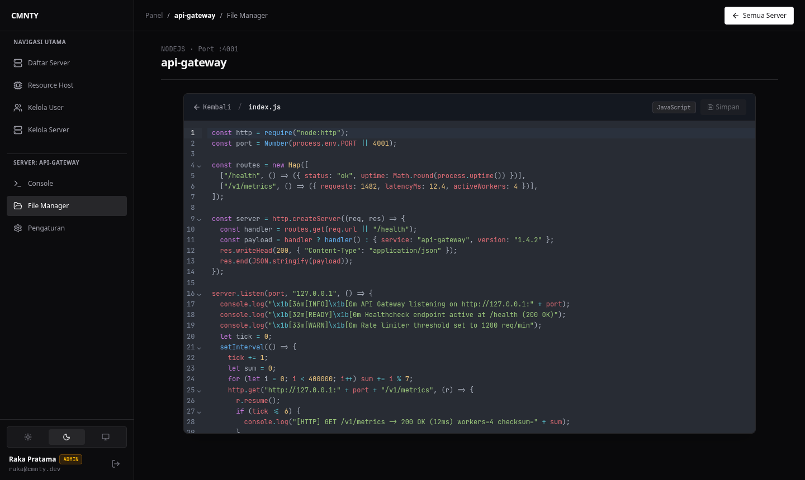
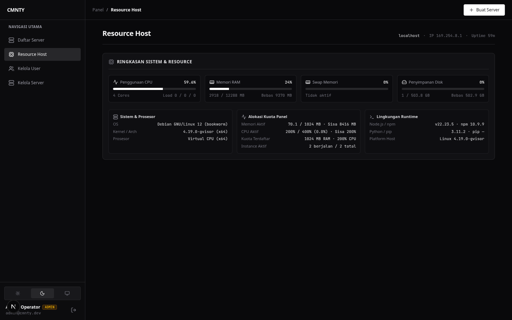

<div align="center">

# cmnty — Node.js & Python Server Management Panel

**A lightweight, self-hosted server management panel for Node.js and Python applications — built for VPS, Docker, local hosts, and cloud containers.**


[Features](#key-features) • [Screenshots](#screenshots) • [Interactive Console](#interactive-console) • [Deployment](#deployment) • [Environment Variables](#environment-variables) • [Project Structure](#project-structure)

<br />


</div>

---

## Key Features

- **Multi-Runtime Process Supervision** — Run and manage **Node.js** (`node`, `npm`, `npx`, `tsx`, `ts-node`, `nodemon`) and **Python** (`python3`, `python`, `uvicorn`, `gunicorn`, `flask`, `fastapi`, `celery`, `hypercorn`, `streamlit`, `pytest`) instances with automatic dependency installation (`package.json` / `requirements.txt`).
- **Real-Time Streaming Console (jQuery Highlighted)** — Stream logs over Server-Sent Events (SSE) with zero-delay partial line flushing, carriage return (`\r`) progress overwrite, **jQuery-powered ANSI & semantic terminal output color highlighting** (SGR/256-color/RGB, HTTP statuses, URLs, timestamps, file paths, JSON keys, CLI flags), command history (`ArrowUp` / `ArrowDown`), and interactive `stdin` forwarding.
- **Live Telemetry & Area Charts** — Track per-server Address port, Uptime, CPU load, RSS memory (with OOM auto-termination), and inbound/outbound network bandwidth rates with real-time Recharts area graphs, alongside a dedicated **Resource Host** overview (`/host`) for OS, kernel, load averages, RAM, Swap, Disk, panel quotas, and installed runtime versions.
- **Integrated File Manager & CodeMirror Editor** — Navigate directories via breadcrumbs, create files/folders, multi-upload files, rename, move (single or bulk), archive/extract `.zip` safely, bulk-delete via a floating action bar, and edit source files inline with a **CodeMirror 6 syntax-highlighted editor** supporting 100+ languages with line numbers, code folding, search (`Ctrl+F` / `Cmd+F`), and `Ctrl+S` / `Cmd+S` save.
- **Auto-Saving Server Settings** — Update startup commands, auto-restart behavior, server name/notes, internal ports (admin), and permanent deletion in `/server/[id]/settings` with instant auto-save.
- **Role-Based Access Control (RBAC)** — First registered account is automatically promoted to `admin` (or optionally provisioned via `ADMIN_USER`, `ADMIN_EMAIL`, and `ADMIN_PASSWORD` in `.env`). Admins manage users (`/admin/user`) and servers (`/admin/server`), perform remote power actions, and transfer server ownership.
- **Sandboxed Execution & Session Security** — Strict directory confinement (`resolveSafePath` + symlink realpath validation), `shell: false` process spawning, isolated server environment variables, `scrypt` password hashing, and HMAC-SHA256 cookie + bearer session tokens backed by an auto-generated `.session-secret`.

---

## Screenshots

### Server Dashboard, Deployment & Live Console

| Servers Dashboard | Real-Time Console & Telemetry |
| :---: | :---: |
|  |  |
| Filter instances by runtime (`Semua Runtime` / `Node.js` / `Python`), search by name or port, and monitor live CPU & RAM usage across all servers. | Power controls (`Start`, `Restart`, `Stop`, `Kill`), live jQuery-highlighted ANSI/semantic log streaming, interactive `stdin` bar, and live CPU/Memory/Network charts. |

| Create Server Modal | Server Settings |
| :---: | :---: |
|  |  |
| Deploy new Node.js or Python instances with runtime presets, owner assignment, startup command, and host-bounded memory/CPU limits. | Auto-saving startup command, auto-restart toggle, server name & notes, internal port configuration, and safe server deletion. |

### File Manager, Code Editor & Host Resources

| Integrated File Manager | Multi-Language CodeMirror Editor |
| :---: | :---: |
|  |  |
| Browse directories via breadcrumbs, create files/folders, multi-upload, rename, move, archive/extract `.zip`, and bulk-delete files safely. | Inline CodeMirror 6 editor with syntax highlighting for 100+ languages, line numbers, code folding, search (`Ctrl+F`), and `Ctrl+S` save. |

| Host System & Runtime Overview | Authentication Screen |
| :---: | :---: |
|  |  |
| Inspect host OS, kernel, CPU load, system/cgroup memory, swap, disk usage, allocated panel quotas, and installed Node.js/Python/npm/pip versions. | Clean sign-in and registration screen with automatic first-admin onboarding and cookie + bearer session support. |

### Administration & Mobile Responsive UI

| Admin Server Management (`/admin/server`) | Admin User Management (`/admin/user`) |
| :---: | :---: |
|  |  |
| Audit all servers, filter by status, monitor live RAM/CPU consumption, trigger remote power actions, or transfer ownership. | Manage user accounts, assign `ADMIN` or `USER` roles, inspect per-user server counts, and audit active panel quotas. |

| Mobile Responsive Dashboard | Mobile Responsive Console |
| :---: | :---: |
|  |  |
| Clean single-column server cards, runtime filters, and slide-out drawer navigation tuned for mobile screens. | Side-by-side 4-button power bar, responsive terminal logs, and 2-column telemetry cards without horizontal overflow. |

---

## Interactive Console

The console command bar (`Input a command...`) is context-aware and activates **only when the running process actively requests standard input (`stdin`)**:

- **Interactive Input Detection:** Built-in runtime hooks automatically detect when a Node.js (`readline`, `process.stdin`, `fs.readSync(0)`) or Python (`input()`, `sys.stdin`, `os.read(0)`) process waits for user input, enabling the input bar in real time via SSE.
- **Disabled When Idle:** When a server is offline, stopping, or running a background HTTP/bot loop that does not read from `stdin`, the command input remains safely locked.
- **Command History:** Use `ArrowUp` and `ArrowDown` to recall previously sent `stdin` lines during interactive prompts (persisted per server in browser `localStorage`).

---

## Deployment

### Option 1: Docker

```bash
# Build the production image
docker build -t cmnty-panel .

# Run with persistent data storage
docker run -d \
  --name cmnty-panel \
  --restart unless-stopped \
  -p 3000:3000 \
  -v cmnty_data:/app/data \
  cmnty-panel
```

### Option 2: Ubuntu / Debian VPS (`install.sh`)

Run the automated installer as `root` or via `sudo` to provision Node.js 22 LTS, Python 3, `pip`, `venv`, swap (when RAM < 2 GB), production build, a `systemd` service, and automatic public VPS IPv4 URL detection:

```bash
git clone <your-repository-url> cmnty
cd cmnty
sudo bash install.sh
```

Useful service management commands:

```bash
sudo systemctl status cmnty-panel
sudo journalctl -u cmnty-panel -f
sudo systemctl restart cmnty-panel
```

### Option 3: Local Development

**Prerequisites:** Node.js `20+` (22 LTS recommended) and Python `3.10+`.

```bash
npm install
# Optionally edit .env to pre-configure ADMIN_* or PANEL_DATA_DIR
npm run dev
```

Open [http://localhost:3000](http://localhost:3000) and register the first account (automatically assigned the `admin` role).

### Option 4: Railway

This repository includes a production `Dockerfile` configured for Railway's dynamic `PORT` and persistent volumes:

1. Push this repository to GitHub and create a **New Project → Deploy from GitHub Repo** on [Railway](https://railway.app).
2. Add a **Volume** mounted at `/app/data` so user accounts, server configurations, `.session-secret`, and server workspaces persist across deployments.
3. Optionally configure Variables in Railway:
   - `APP_URL` — your Railway public URL (e.g. `https://your-app.up.railway.app`)
   - `ADMIN_USER`, `ADMIN_EMAIL`, `ADMIN_PASSWORD` — optional pre-configured administrator account
4. Deploy. Railway builds the Docker image and binds to `0.0.0.0:$PORT`.

---

## Environment Variables

See [`.env`](.env) for configuration options:

| Variable | Required | Default | Description |
| :--- | :---: | :--- | :--- |
| `PANEL_DATA_DIR` | Optional | `./data` | Custom directory path for `panel-db.json`, `.session-secret`, and server workspaces. |
| `ADMIN_USER` | Optional | `Admin` | Display name for an optional pre-configured administrator account (requires `ADMIN_EMAIL` & `ADMIN_PASSWORD`). |
| `ADMIN_EMAIL` | Optional | — | Email address for the optional environment-configured administrator account. |
| `ADMIN_PASSWORD` | Optional | — | Password (6–128 chars) for the optional environment-configured administrator account. |
| `APP_URL` | Optional | `RAILWAY_PUBLIC_DOMAIN` or `http://localhost:3000` | Public origin URL used for metadata, `robots.txt`, and `sitemap.xml`. |
| `PORT` | Optional | `3000` | HTTP port bound by the Next.js server. |
| `NODE_ENV` | Production | `production` | Runtime mode (`production` for deployments). |

---

## Tech Stack

- **Framework:** Next.js 15 (App Router), React 19, TypeScript
- **Styling & UI:** Tailwind CSS v4, Lucide Icons, Motion, Recharts, SweetAlert2
- **Code Editor:** CodeMirror 6 (`@codemirror/view`, `@codemirror/state`, `@codemirror/language`, `@codemirror/language-data`, `@codemirror/commands`, `@codemirror/search`, `@codemirror/theme-one-dark`)
- **Console Highlighting:** jQuery (`jquery`) dedicated strictly to colored ANSI & semantic terminal output spans
- **Real-Time Streaming:** Native Node.js `ReadableStream` Server-Sent Events (SSE)
- **Persistence:** Atomic JSON datastore (`data/panel-db.json`) with write lock and auto-generated `.session-secret`
- **Process Supervision:** Native `node:child_process` tree manager with Linux `/proc` & cgroup sampling, network rate counters, and `stdin` hooks

---

## Project Structure

```text
├── app/
│   ├── (panel)/                     # Protected dashboard, host, admin, and server workspace routes
│   ├── api/                         # Auth, admin, host telemetry, SSE stream, power, files, and console APIs
│   ├── login/ & register/           # Authentication routes
│   └── globals.css                  # Tailwind CSS v4 setup & theme utilities
├── components/
│   ├── code-editor.tsx              # CodeMirror 6 multi-language syntax-highlighted code editor
│   ├── console-jquery-highlight.tsx # jQuery-based terminal output text colorizer
│   ├── server-console.tsx           # Real-time SSE console, power controls & Recharts telemetry
│   ├── server-files.tsx             # File manager (CRUD, upload, bulk actions, ZIP, CodeEditor)
│   ├── server-settings.tsx          # Auto-saving startup, metadata, port & deletion settings
│   ├── host-resources.tsx           # Host hardware, quota & runtime overview
│   ├── admin-panel.tsx              # Admin user & server management views
│   └── ...                          # Shell, dashboard, auth form, modals & skeletons
├── docs/screenshots/                # Web UI screenshots used in documentation
├── lib/
│   ├── auth.ts                      # scrypt password hashing & HMAC-SHA256 session tokens
│   ├── code-language.ts             # Filename-to-CodeMirror language resolver (100+ languages)
│   ├── console-highlight.ts         # ANSI SGR/256/RGB & semantic log tokenizer
│   ├── console-state.ts             # Power button & stdin input availability helpers
│   ├── console-stream.ts            # Partial-line & carriage-return SSE stream parser
│   ├── db.ts                        # Atomic JSON database, optional env admin sync & workspaces
│   ├── files.ts                     # Sandboxed file CRUD, ZIP archive/extract & .env handling
│   ├── host-stats.ts                # Host & cgroup CPU/RAM/Swap/Disk telemetry helpers
│   ├── network-stats.ts             # Per-server inbound/outbound network rate counters
│   ├── processes.ts                 # Child process lifecycle, metrics & stdin hooks
│   ├── resource-limits.ts           # Host-bounded memory & CPU quota option generators
│   └── security.ts                  # Path traversal guards & runtime command validators
├── Dockerfile                       # Production image for Docker & Railway deployments
├── install.sh                       # Automated Ubuntu/Debian systemd installer
└── .env                             # Environment variable configuration
```

---

## License

This project is open-source software. Review and customize access policies before exposing your host to untrusted users.
