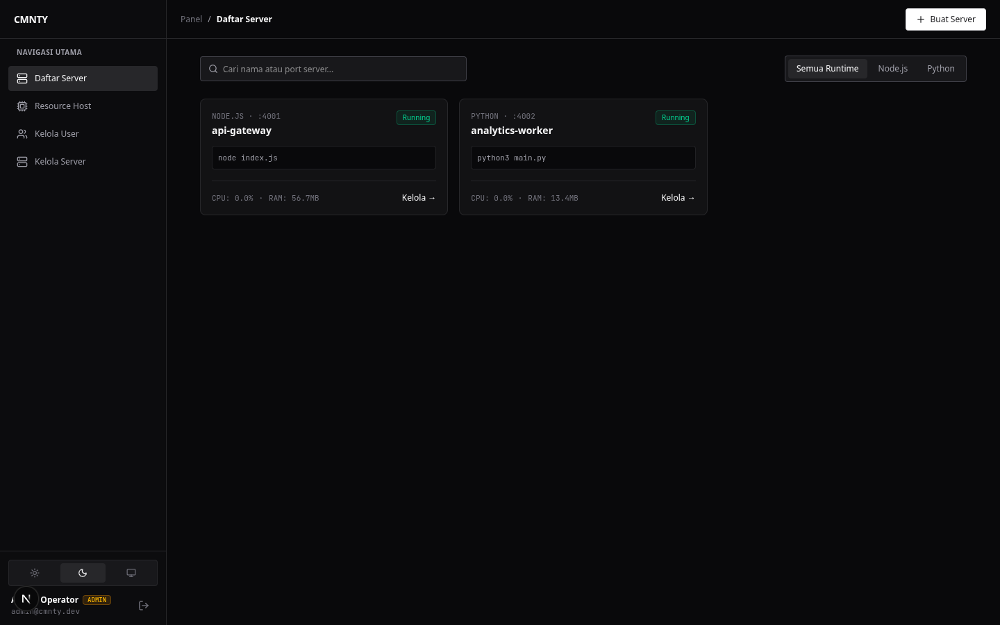

<div align="center">

# cmnty — Node.js & Python Server Management Panel

**A modern, lightweight, self-hosted server management panel for Node.js and Python applications — built for VPS, Docker, Railway, and NAT Gateway environments.**


[Features](#key-features) • [Screenshots](#screenshots) • [Interactive Console](#interactive-console) • [Deployment](#deployment) • [Environment Variables](#environment-variables) • [Architecture](#project-structure)

<br />


</div>

---

## Key Features

- **Multi-Runtime Process Supervision** — Run and manage **Node.js** (`node`, `npm`, `npx`, `tsx`, `ts-node`, `nodemon`) and **Python** (`python3`, `python`, `uvicorn`, `gunicorn`, `flask`, `fastapi`, `celery`, `hypercorn`, `streamlit`, `pytest`) instances with automatic dependency installation (`package.json` / `requirements.txt`).
- **Real-Time Streaming Console** — Powered by Server-Sent Events (SSE) with zero-delay partial line flushing, carriage return (`\r`) progress overwrite, ANSI color highlighting, command history (`ArrowUp` / `ArrowDown`), and interactive `stdin` forwarding when a running process requests input.
- **Live Resource Telemetry & Quotas** — Monitor per-server CPU load, RSS memory (with OOM auto-termination), uptime, and inbound/outbound network rates alongside host-level CPU, RAM, Swap, Disk, and runtime versions.
- **Integrated File Manager** — Browse directories with clickable breadcrumbs, edit text/code files inline, upload files, extract `.zip` archives safely, and manage server-scoped `.env` variables.
- **Role-Based Access Control (RBAC)** — First registered account is promoted to `admin` automatically (or optionally configured via `ADMIN_USER`, `ADMIN_EMAIL`, and `ADMIN_PASSWORD`); admins can manage users, transfer server ownership, enforce RAM/CPU limits, and inspect all instances.
- **Sandboxed Execution** — Strict directory confinement (`resolveSafePath` + symlink realpath checks), `shell: false` process spawning, isolated server environment variables, and `scrypt` + HMAC-SHA256 session security.

---

## Screenshots

### Server Dashboard & Live Console

| Servers Dashboard | Real-Time Console & Telemetry |
| :---: | :---: |
|  |  |
| Filter instances by runtime (`Node.js` / `Python`), search by name or port, and track live status & resource usage. | Power controls (`Start`, `Restart`, `Stop`, `Kill`), live ANSI log streaming, interactive `stdin` bar, and CPU/Memory/Network charts. |

### File Manager & Host Resources

| Integrated File Manager | Host System & Runtime Overview |
| :---: | :---: |
|  |  |
| Navigate folders via clickable breadcrumbs, create/edit/upload files, and extract ZIP packages directly inside each server directory. | Inspect host OS, kernel, CPU load, cgroup/system memory, swap, disk usage, allocated panel quotas, and installed Node.js/Python versions. |

### Administration & Authentication

| Admin Server Management | Authentication Screen |
| :---: | :---: |
|  |  |
| Manage all servers and user accounts, perform remote power actions, transfer ownership, and audit active quotas. | Clean dark/light themed sign-in and first-admin onboarding screen with cookie + bearer session support. |

---

## Interactive Console

The console command bar (`Input a command...`) is context-aware and activates **only when the running process actively requests standard input (`stdin`)**:

- **Interactive Input Detection:** Built-in runtime hooks automatically detect when a Node.js (`readline`, `process.stdin`, `fs.readSync(0)`) or Python (`input()`, `sys.stdin`, `os.read(0)`) process waits for user input, enabling the input bar in real time via SSE.
- **Disabled When Idle or Non-Interactive:** When a server is offline, stopping, or running a background HTTP/bot loop that does not read from `stdin`, the command input remains safely locked.
- **Command History:** Use `ArrowUp` and `ArrowDown` to recall previously sent `stdin` lines during interactive prompts.

---

## Deployment

### Option 1: Railway (Recommended)

This repository includes a production-hardened `Dockerfile` configured for Railway's dynamic `PORT` and persistent volumes.

1. Push this repository to GitHub and create a **New Project → Deploy from GitHub Repo** on [Railway](https://railway.app).
2. Add a **Volume** mounted at `/app/data` so user accounts, server configurations, and server workspaces persist across deployments.
3. Set the following Variables in Railway:
   - `PANEL_SESSION_SECRET` — a long random string (`openssl rand -hex 32`)
   - `APP_URL` — your Railway public URL (e.g. `https://your-app.up.railway.app`)
4. Deploy. Railway builds the Docker image and starts the panel on `0.0.0.0:$PORT`.

---

### Option 2: Docker

```bash
# Build the production image
docker build -t cmnty-panel .

# Run with persistent data storage
docker run -d \
  --name cmnty-panel \
  --restart unless-stopped \
  -p 3000:3000 \
  -e PANEL_SESSION_SECRET="$(openssl rand -hex 32)" \
  -v cmnty_data:/app/data \
  cmnty-panel
```

---

### Option 3: Ubuntu / Debian VPS (`install.sh`)

Run the automated installer script as `root` or via `sudo` to provision Node.js 22 LTS, Python 3, `pip`, `venv`, swap (if RAM < 2 GB), production build, and a `systemd` service:

```bash
git clone <your-repository-url> cmnty
cd cmnty
sudo bash install.sh
```

Useful service management commands after installation:

```bash
sudo systemctl status cmnty-panel
sudo journalctl -u cmnty-panel -f
sudo systemctl restart cmnty-panel
```

---

### Option 4: Local Development

**Prerequisites:** Node.js `20+` (22 LTS recommended) and Python `3.10+`.

```bash
npm install
cp .env.example .env
npm run dev
```

Open [http://localhost:3000](http://localhost:3000) in your browser and create the first account (automatically assigned the `admin` role).

---

## Environment Variables

See [`.env.example`](.env.example) for the starter template:

| Variable | Required | Default | Description |
| :--- | :---: | :--- | :--- |
| `PANEL_SESSION_SECRET` | Recommended | Auto-generated in `<DATA_DIR>/.session-secret` | Secret key (`>= 16` chars) used to sign HMAC-SHA256 session tokens. |
| `PANEL_DATA_DIR` | Optional | `./data` | Custom directory path for `panel-db.json` and per-server workspaces. |
| `ADMIN_USER` | Optional | `Admin` | Display name for an optional pre-configured administrator account (requires `ADMIN_EMAIL` and `ADMIN_PASSWORD`). |
| `ADMIN_EMAIL` | Optional | — | Email address for the optional environment-configured administrator account. |
| `ADMIN_PASSWORD` | Optional | — | Password (6–128 chars) for the optional environment-configured administrator account. |
| `APP_URL` | Optional | `RAILWAY_PUBLIC_DOMAIN` or `http://localhost:3000` | Public origin URL used for metadata, `robots.txt`, and `sitemap.xml`. |
| `PORT` | Optional | `3000` | HTTP port bound by the Next.js server. |
| `NODE_ENV` | Production | `production` | Runtime mode (`production` for deployments). |

---

## Tech Stack

- **Framework:** Next.js 15 (App Router), React 19, TypeScript
- **Styling & UI:** Tailwind CSS v4, Lucide Icons, Motion, Recharts, SweetAlert2
- **Real-Time Streaming:** Native Node.js `ReadableStream` Server-Sent Events (SSE)
- **Persistence:** Atomic JSON datastore (`data/panel-db.json`) with write serialization lock
- **Process Supervision:** Native `node:child_process` tree manager with Linux `/proc` & cgroup resource sampling, socket-level network byte counters, and `stdin` activity hooks

---

## Project Structure

```text
├── app/
│   ├── (panel)/              # Protected dashboard, host, admin, and server workspace routes
│   ├── api/                  # Auth, admin, host telemetry, SSE stream, power, files, and console APIs
│   ├── login/ & register/    # Authentication routes
│   └── globals.css           # Tailwind CSS v4 setup & theme utilities
├── components/               # Client views, terminal console, file manager, charts, and skeletons
├── docs/screenshots/         # Web UI screenshots used in documentation
├── lib/
│   ├── auth.ts               # scrypt password hashing & HMAC-SHA256 token verification
│   ├── console-state.ts      # Power button & stdin input availability helpers
│   ├── console-stream.ts     # Partial-line & carriage-return SSE stream parser
│   ├── db.ts                 # Atomic JSON database, optional env admin sync & workspaces
│   ├── files.ts              # Sandboxed file CRUD, ZIP extraction, and .env handling
│   ├── processes.ts          # Child process lifecycle, metrics, and stdin hooks
│   └── security.ts           # Path traversal guards & runtime command validators
├── Dockerfile                # Production image for Railway & Docker deployments
├── install.sh                # Automated Ubuntu/Debian systemd installer
└── .env.example              # Environment variable template
```

---

## License

This project is open-source software. Review and customize access policies before exposing your host to untrusted users.
