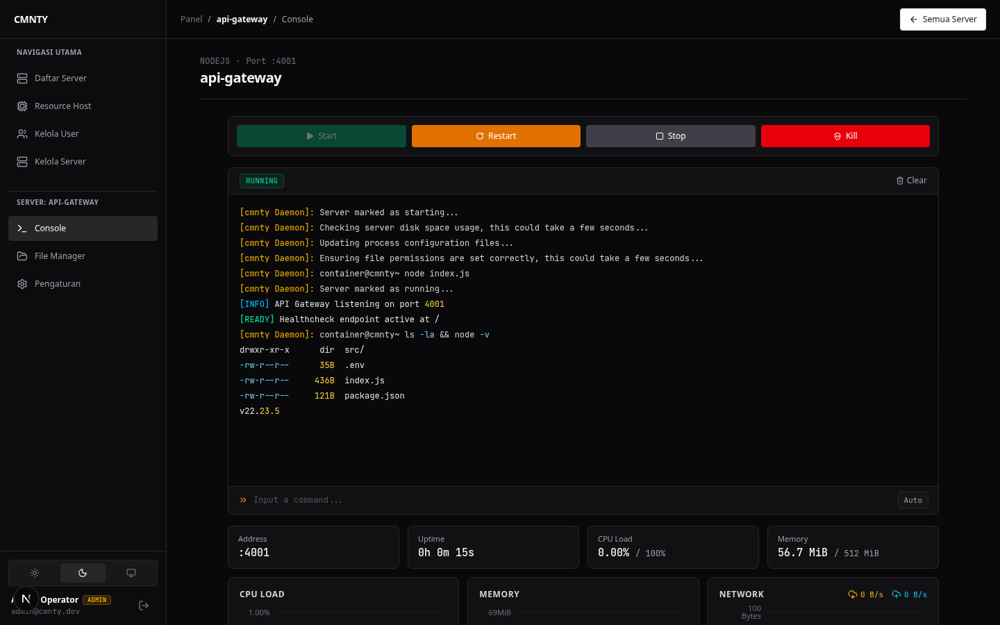
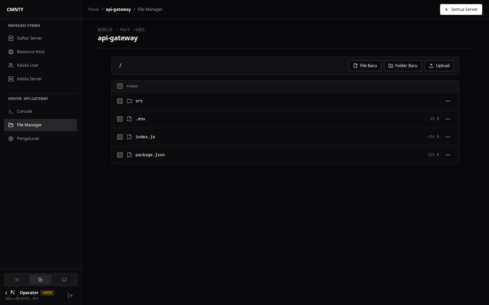
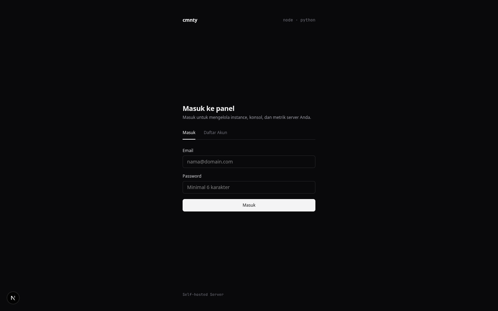
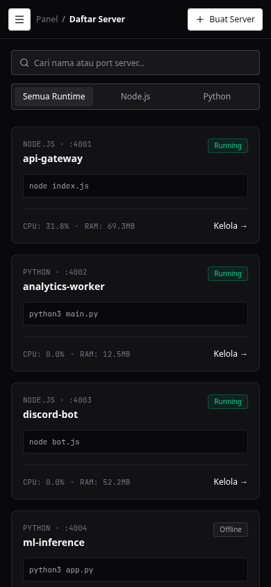
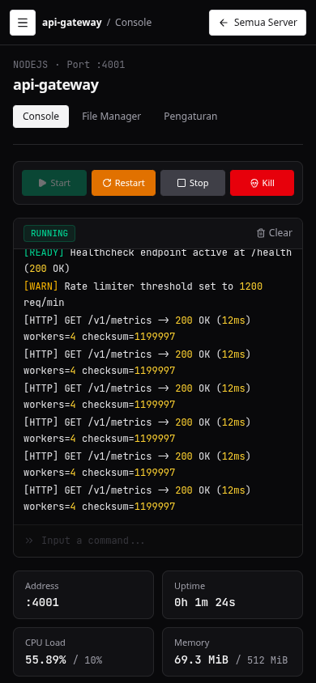

<div align="center">

# cmnty — Panel Manajemen Server Node.js & Python

**Panel manajemen server mandiri (self-hosted) yang ringan untuk aplikasi Node.js dan Python — dirancang untuk VPS, Docker, host lokal, dan kontainer cloud.**


[Fitur Utama](#fitur-utama) • [Tangkapan Layar](#tangkapan-layar) • [Konsol Interaktif](#konsol-interaktif) • [Deployment](#deployment) • [Variabel Lingkungan](#variabel-lingkungan) • [Struktur Proyek](#struktur-proyek)

<br />



</div>

---

## Fitur Utama

- **Supervisi Proses Multi-Runtime** — Jalankan dan kelola instance **Node.js** (`node`, `npm`, `npx`, `tsx`, `ts-node`, `nodemon`) dan **Python** (`python3`, `python`, `uvicorn`, `gunicorn`, `flask`, `fastapi`, `celery`, `hypercorn`, `streamlit`, `pytest`) dengan instalasi dependensi otomatis (`package.json` / `requirements.txt`).
- **Konsol Streaming Real-Time (Highlight jQuery)** — Streaming log melalui Server-Sent Events (SSE) dengan zero-delay partial line flushing, carriage return (`\r`) progress overwrite, **highlight warna terminal output ANSI & semantik berbasis jQuery** (SGR/256-color/RGB, status HTTP, URL, timestamp, jalur file, key JSON, flag CLI), riwayat perintah (`ArrowUp` / `ArrowDown`), dan penerusan `stdin` interaktif.
- **Telemetri Langsung & Grafik Area** — Lacak port Address per server, Uptime, beban CPU, memori RSS (dengan auto-terminasi OOM), dan laju bandwidth jaringan masuk/keluar dengan grafik area Recharts waktu nyata, serta ringkasan **Resource Host** khusus (`/host`) untuk OS, kernel, rata-rata beban, RAM, Swap, Disk, kuota panel, dan versi runtime terinstal.
- **Manajer File Terintegrasi & Editor CodeMirror** — Navigasi direktori melalui breadcrumbs, buat file/folder, multi-upload file, ubah nama, pindahkan (tunggal atau massal), arsip/ekstrak `.zip` dengan aman, hapus massal melalui action bar melayang, dan edit file sumber secara inline dengan **editor ber-highlight syntax CodeMirror 6** yang mendukung 100+ bahasa dengan nomor baris, pelipatan kode, pencarian (`Ctrl+F` / `Cmd+F`), dan penyimpanan `Ctrl+S` / `Cmd+S`.
- **Pengaturan Server Simpan-Otomatis** — Perbarui perintah startup, perilaku auto-restart, nama/catatan server, port internal (admin), dan penghapusan aman di `/server/[id]/settings` dengan penyimpanan otomatis instan.
- **Kontrol Akses Berbasis Peran (RBAC)** — Akun pertama yang terdaftar secara otomatis dipromosikan menjadi `admin` (atau opsional melalui `ADMIN_USER`, `ADMIN_EMAIL`, dan `ADMIN_PASSWORD` di `.env`). Admin mengelola pengguna (`/admin/user`) dan server (`/admin/server`), melakukan tindakan power jarak jauh, dan mentransfer kepemilikan server.
- **Eksekusi Terisolasi (Sandbox) & Keamanan Sesi** — Pembatasan direktori ketat (`resolveSafePath` + validasi symlink realpath), pemijahan proses `shell: false`, variabel lingkungan server terisolasi, hashing password `scrypt`, serta token sesi cookie + bearer HMAC-SHA256 yang didukung oleh `.session-secret` yang dibuat otomatis.

---

## Tangkapan Layar

### Dasbor Server, Deployment & Konsol Langsung

| Dasbor Server | Konsol & Telemetri Real-Time |
| :---: | :---: |
|  |  |
| Filter instance berdasarkan runtime (`Semua Runtime` / `Node.js` / `Python`), cari berdasarkan nama atau port, dan pantau penggunaan CPU & RAM secara langsung di semua server. | Kontrol daya (`Start`, `Restart`, `Stop`, `Kill`), streaming log ANSI/semantik ber-highlight jQuery, bar `stdin` interaktif, serta grafik CPU/Memory/Network langsung. |

| Modal Buat Server | Pengaturan Server |
| :---: | :---: |
|  |  |
| Deploy instance Node.js atau Python baru dengan preset runtime, penugasan pemilik, perintah startup, dan batas memori/CPU yang dibatasi host. | Perintah startup simpan-otomatis, toggle auto-restart, nama & catatan server, konfigurasi port internal, dan penghapusan server yang aman. |

### Manajer File, Editor Kode & Sumber Daya Host

| Manajer File Terintegrasi | Editor Kode CodeMirror Multi-Bahasa |
| :---: | :---: |
|  |  |
| Jelajahi direktori melalui breadcrumbs, buat file/folder, multi-upload, ubah nama, pindahkan, arsip/ekstrak `.zip`, dan hapus file massal dengan aman. | Editor CodeMirror 6 inline dengan highlight syntax untuk 100+ bahasa, nomor baris, pelipatan kode, pencarian (`Ctrl+F`), dan penyimpanan `Ctrl+S`. |

| Ikhtisar Sistem Host & Runtime | Layar Autentikasi |
| :---: | :---: |
|  |  |
| Periksa OS host, kernel, beban CPU, memori sistem/cgroup, swap, penggunaan disk, kuota panel yang dialokasikan, dan versi Node.js/Python/npm/pip yang terinstal. | Layar masuk dan pendaftaran yang bersih dengan orientasi admin pertama otomatis serta dukungan sesi cookie + bearer. |

### Administrasi & UI Responsif Seluler

| Manajemen Server Admin (`/admin/server`) | Manajemen Pengguna Admin (`/admin/user`) |
| :---: | :---: |
|  |  |
| Audit semua server, filter berdasarkan status, pantau konsumsi RAM/CPU secara langsung, picu tindakan power jarak jauh, atau transfer kepemilikan. | Kelola akun pengguna, tetapkan peran `ADMIN` atau `USER`, periksa jumlah server per pengguna, dan audit kuota panel aktif. |

| Dasbor Responsif Seluler | Konsol Responsif Seluler |
| :---: | :---: |
|  |  |
| Kartu server satu kolom yang rapi, filter runtime, dan navigasi laci slide-out yang dioptimalkan untuk layar ponsel. | Bar power 4 tombol berdampingan, log terminal responsif, dan kartu telemetri 2 kolom tanpa luapan horizontal. |

---

## Konsol Interaktif

Bar perintah konsol (`Input a command...`) bersifat sadar konteks dan aktif **hanya ketika proses yang berjalan secara aktif meminta input standar (`stdin`)**:

- **Deteksi Input Interaktif:** Hook runtime bawaan mendeteksi secara otomatis ketika proses Node.js (`readline`, `process.stdin`, `fs.readSync(0)`) atau Python (`input()`, `sys.stdin`, `os.read(0)`) menunggu input pengguna, mengaktifkan bar input secara real-time melalui SSE.
- **Dinonaktifkan Saat Idle:** Ketika server offline, berhenti, atau menjalankan loop HTTP/bot latar belakang yang tidak membaca dari `stdin`, input perintah tetap terkunci dengan aman.
- **Riwayat Perintah:** Gunakan `ArrowUp` dan `ArrowDown` untuk memanggil kembali baris `stdin` yang dikirimkan sebelumnya selama prompt interaktif (disimpan per server di `localStorage` peramban).

---

## Deployment

### Opsi 1: Docker

```bash
# Build image produksi
docker build -t cmnty-panel .

# Jalankan dengan penyimpanan data persisten
docker run -d \
  --name cmnty-panel \
  --restart unless-stopped \
  -p 3000:3000 \
  -v cmnty_data:/app/data \
  cmnty-panel
```

### Opsi 2: VPS Ubuntu / Debian (`install.sh`)

Jalankan instalasi otomatis sebagai `root` atau melalui `sudo` untuk memprovisi Node.js 22 LTS, Python 3, `pip`, `venv`, swap (jika RAM < 2 GB), build produksi, layanan `systemd`, dan deteksi otomatis URL IPv4 publik VPS:

```bash
git clone <url-repositori-anda> cmnty
cd cmnty
sudo bash install.sh
```

Perintah manajemen layanan yang berguna:

```bash
sudo systemctl status cmnty-panel
sudo journalctl -u cmnty-panel -f
sudo systemctl restart cmnty-panel
```

### Opsi 3: Pengembangan Lokal

**Prasyarat:** Node.js `20+` (disarankan 22 LTS) dan Python `3.10+`.

```bash
npm install
# Opsional: edit file .env untuk pra-konfigurasi ADMIN_* atau PANEL_DATA_DIR
npm run dev
```

Buka [http://localhost:3000](http://localhost:3000) dan daftarkan akun pertama (secara otomatis diberi peran `admin`).

### Opsi 4: Railway

Repositori ini mencakup `Dockerfile` produksi yang dikonfigurasi untuk `PORT` dinamis Railway dan volume persisten:

1. Dorong repositori ini ke GitHub dan buat **New Project → Deploy from GitHub Repo** di [Railway](https://railway.app).
2. Tambahkan **Volume** yang dipasang di `/app/data` sehingga akun pengguna, konfigurasi server, `.session-secret`, dan workspace server bertahan di setiap deployment.
3. Opsional: Konfigurasikan Variabel di Railway:
   - `APP_URL` — URL publik Railway Anda (mis. `https://your-app.up.railway.app`)
   - `ADMIN_USER`, `ADMIN_EMAIL`, `ADMIN_PASSWORD` — akun administrator opsional yang telah dikonfigurasi sebelumnya
4. Deploy. Railway mem-build image Docker dan mengikat ke `0.0.0.0:$PORT`.

---

## Variabel Lingkungan

Lihat [`.env`](.env) untuk opsi konfigurasi:

| Variabel | Wajib | Default | Deskripsi |
| :--- | :---: | :--- | :--- |
| `PANEL_DATA_DIR` | Opsional | `./data` | Jalur direktori kustom untuk `panel-db.json`, `.session-secret`, dan workspace server. |
| `ADMIN_USER` | Opsional | `Admin` | Nama tampilan untuk akun administrator opsional (membutuhkan `ADMIN_EMAIL` & `ADMIN_PASSWORD`). |
| `ADMIN_EMAIL` | Opsional | — | Alamat email untuk akun administrator yang dikonfigurasi melalui environment. |
| `ADMIN_PASSWORD` | Opsional | — | Password (6–128 karakter) untuk akun administrator yang dikonfigurasi melalui environment. |
| `APP_URL` | Opsional | `RAILWAY_PUBLIC_DOMAIN` atau `http://localhost:3000` | URL asal publik yang digunakan untuk metadata, `robots.txt`, dan `sitemap.xml`. |
| `PORT` | Opsional | `3000` | Port HTTP yang diikat oleh server Next.js. |
| `NODE_ENV` | Produksi | `production` | Mode runtime (`production` untuk deployment). |

---

## Teknologi yang Digunakan

- **Framework:** Next.js 15 (App Router), React 19, TypeScript
- **Styling & UI:** Tailwind CSS v4, Lucide Icons, Motion, Recharts, SweetAlert2
- **Editor Kode:** CodeMirror 6 (`@codemirror/view`, `@codemirror/state`, `@codemirror/language`, `@codemirror/language-data`, `@codemirror/commands`, `@codemirror/search`, `@codemirror/theme-one-dark`)
- **Highlight Konsol:** jQuery (`jquery`) yang didedikasikan secara ketat untuk span teks warna output ANSI & semantik terminal
- **Streaming Real-Time:** Server-Sent Events (SSE) `ReadableStream` bawaan Node.js
- **Persistensi:** Datastore JSON atomik (`data/panel-db.json`) dengan write lock dan `.session-secret` otomatis
- **Supervisi Proses:** Manajer pohon `node:child_process` bawaan dengan sampling Linux `/proc` & cgroup, penghitung laju jaringan, dan hook `stdin`

---

## Struktur Proyek

```text
├── app/
│   ├── (panel)/                     # Rute dasbor, host, admin, dan workspace server yang dilindungi
│   ├── api/                         # API autentikasi, admin, telemetri host, stream SSE, power, file, dan konsol
│   ├── login/ & register/           # Rute autentikasi
│   └── globals.css                  # Pengaturan Tailwind CSS v4 & utilitas tema
├── components/
│   ├── code-editor.tsx              # Editor kode CodeMirror 6 multi-bahasa ber-highlight syntax
│   ├── console-jquery-highlight.tsx # Pewarna teks output terminal berbasis jQuery
│   ├── server-console.tsx           # Konsol SSE real-time, kontrol power & telemetri Recharts
│   ├── server-files.tsx             # Manajer file (CRUD, upload, aksi massal, ZIP, CodeEditor)
│   ├── server-settings.tsx          # Pengaturan startup, metadata, port & hapus simpan-otomatis
│   ├── host-resources.tsx           # Ikhtisar perangkat keras host, kuota & runtime
│   ├── admin-panel.tsx              # Tampilan manajemen pengguna & server admin
│   └── ...                          # Shell, dasbor, formulir auth, modal & skeleton
├── docs/screenshots/                # Tangkapan layar UI web yang digunakan dalam dokumentasi
├── lib/
│   ├── auth.ts                      # Hashing password scrypt & token sesi HMAC-SHA256
│   ├── code-language.ts             # Resolver bahasa CodeMirror dari nama file (100+ bahasa)
│   ├── console-highlight.ts         # Tokenizer log ANSI SGR/256/RGB & semantik
│   ├── console-state.ts             # Helper ketersediaan tombol power & input stdin
│   ├── console-stream.ts            # Parser stream SSE partial-line & carriage-return
│   ├── db.ts                        # Database JSON atomik, sinkronisasi admin env opsional & workspace
│   ├── files.ts                     # CRUD file terisolasi, arsip/ekstrak ZIP & penanganan .env
│   ├── host-stats.ts                # Helper telemetri CPU/RAM/Swap/Disk host & cgroup
│   ├── network-stats.ts             # Penghitung laju jaringan masuk/keluar per server
│   ├── processes.ts                 # Siklus hidup proses anak, metrik & hook stdin
│   ├── resource-limits.ts           # Generator opsi kuota memori & CPU yang dibatasi host
│   └── security.ts                  # Pelindung path traversal & validator perintah runtime
├── Dockerfile                       # Image produksi untuk deployment Docker & Railway
├── install.sh                       # Pemasang systemd Ubuntu/Debian otomatis
└── .env                             # Konfigurasi variabel lingkungan
```

---

## Lisensi

Proyek ini adalah perangkat lunak open-source. Tinjau dan sesuaikan kebijakan akses sebelum mengekspos host Anda ke pengguna yang tidak dipercaya.
