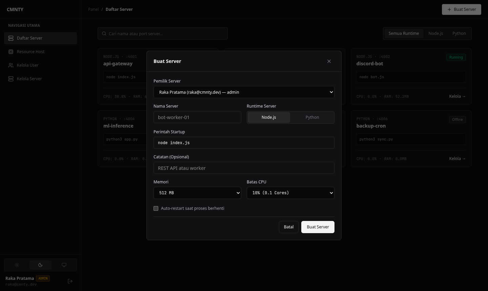
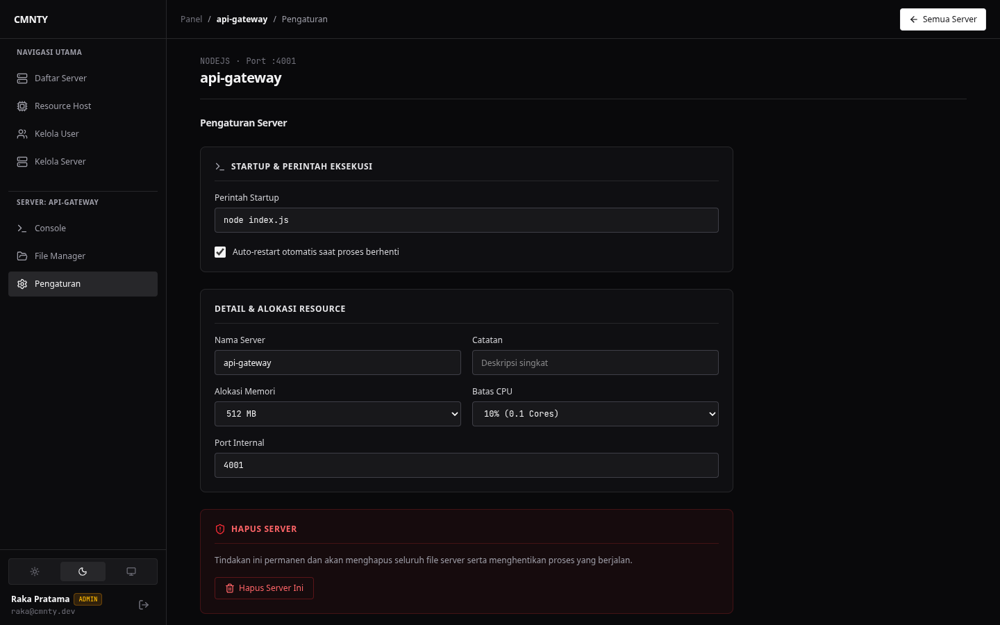
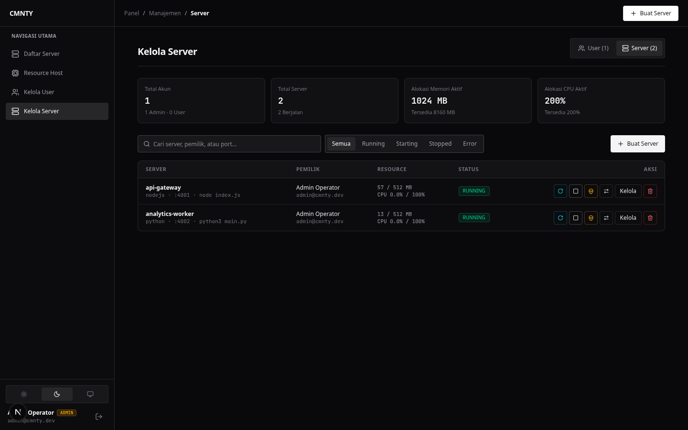
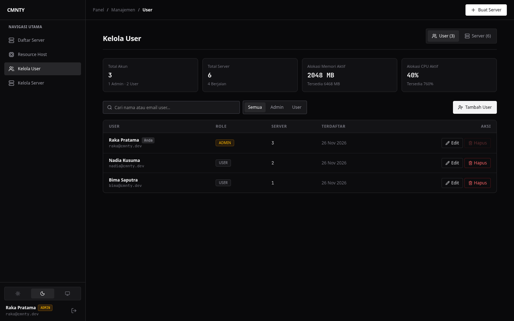

<div align="center">

# cmnty panel — Node.js & Python Server

**A lightweight, self-hosted server management panel for Node.js and Python applications — built for VPS, Docker, local hosts, and cloud containers.**


[Key Features](#key-features) • [Screenshots](#screenshots) • [Interactive Console](#interactive-console) • [Deployment](#deployment) • [Environment Variables](#environment-variables) • [Project Structure](#project-structure)

<br />


</div>

---

## Key Features

- **Supervisi Proses Multi-Runtime** — Jalankan dan kelola instance **Node.js** (`node`, `npm`, `npx`, `tsx`, `ts-node`, `nodemon`) dan **Python** (`python3`, `python`, `uvicorn`, `gunicorn`, `flask`, `fastapi`, `celery`, `hypercorn`, `streamlit`, `pytest`) dengan instalasi dependensi otomatis (`package.json` / `requirements.txt`).
- **Konsol Streaming Real-Time (Highlight jQuery)** — Streaming log melalui Server-Sent Events (SSE) dengan zero-delay partial line flushing, carriage return (`\r`) progress overwrite, **highlight warna terminal output ANSI & semantik berbasis jQuery** (SGR/256-color/RGB, status HTTP, URL, timestamp, jalur file, key JSON, flag CLI), riwayat perintah (`ArrowUp` / `ArrowDown`), dan penerusan `stdin` interaktif.
- **Telemetri Langsung & Grafik Area** — Lacak port Address per server, Uptime, beban CPU, memori RSS (dengan auto-terminasi OOM), dan laju bandwidth jaringan masuk/keluar dengan grafik area Recharts waktu nyata, serta ringkasan **Resource Host** khusus (`/host`) untuk OS, kernel, rata-rata beban, RAM, Swap, Disk, kuota panel, dan versi runtime terinstal.
- **Manajer File Terintegrasi & Editor CodeMirror** — Navigasi direktori melalui breadcrumbs, buat file/folder, multi-upload file, ubah nama, pindahkan (tunggal atau massal), arsip/ekstrak `.zip` dengan aman, hapus massal melalui action bar melayang, dan edit file sumber secara inline dengan **editor ber-highlight syntax CodeMirror 6** yang mendukung 100+ bahasa dengan nomor baris, pelipatan kode, pencarian (`Ctrl+F` / `Cmd+F`), dan penyimpanan `Ctrl+S` / `Cmd+S`.
- **Pengaturan Server Simpan-Otomatis** — Perbarui perintah startup, perilaku auto-restart, nama/catatan server, port internal (admin), dan penghapusan aman di `/server/[id]/settings` dengan penyimpanan otomatis instan.
- **Kontrol Akses Berbasis Peran (RBAC)** — Akun pertama yang terdaftar secara otomatis dipromosikan menjadi `admin` (atau opsional melalui `ADMIN_USER`, `ADMIN_EMAIL`, dan `ADMIN_PASSWORD` di `.env`). Admin mengelola pengguna (`/admin/user`) dan server (`/admin/server`), melakukan tindakan power jarak jauh, dan mentransfer kepemilikan server.
- **Eksekusi Terisolasi (Sandbox) & Keamanan Sesi** — Pembatasan direktori ketat (`resolveSafePath` + validasi symlink realpath), pemijahan proses `shell: false`, variabel lingkungan server terisolasi, hashing password `scrypt`, serta token sesi cookie + bearer HMAC-SHA256 yang didukung oleh `.session-secret` yang dibuat otomatis.

---

## Screenshots

### Server Dashboard, Deployment & Live Console

| Servers Dashboard | Real-Time Console & Telemetry |
| :---: | :---: |
|  |  |

| Create Server Modal | Server Settings |
| :---: | :---: |
|  |  |

### Integrated File Manager, Code Editor & Host Resources

| Integrated File Manager | Multi-Language CodeMirror Editor |
| :---: | :---: |
|  |  |

| Host System & Runtime Overview | Authentication Screen |
| :---: | :---: |
|  |  |

### Administration & Mobile Responsive UI

| Admin Server Management (`/admin/server`) | Admin User Management (`/admin/user`) |
| :---: | :---: |
|  |  |

| Mobile Responsive Dashboard | Mobile Responsive Console |
| :---: | :---: |
|  |  |

---

## Interactive Console

Bar perintah konsol (`Input a command...`) bersifat sadar konteks dan aktif **hanya ketika proses yang berjalan secara aktif meminta input standar (`stdin`)**:

- **Deteksi Input Interaktif:** Hook runtime bawaan mendeteksi secara otomatis ketika proses Node.js (`readline`, `process.stdin`, `fs.readSync(0)`) atau Python (`input()`, `sys.stdin`, `os.read(0)`) menunggu input pengguna, mengaktifkan bar input secara real-time melalui SSE.
- **Dinonaktifkan Saat Idle:** Ketika server offline, berhenti, atau menjalankan loop HTTP/bot latar belakang yang tidak membaca dari `stdin`, input perintah tetap terkunci dengan aman.
- **Riwayat Perintah:** Gunakan `ArrowUp` dan `ArrowDown` untuk memanggil kembali baris `stdin` yang dikirimkan sebelumnya selama prompt interaktif (disimpan per server di `localStorage` peramban).

---

## Deployment

### Option 1: Docker

```bash
# Build image produksi
docker build -t cmnty-panel .

# Jalankan dengan penyimpanan data persisten
docker run -d \
  --name cmnty-panel \
  --restart unless-stopped \
  -p 3000:3000 \
  -v cmnty_data:/app/data \
  cmnty-panel
```

### Option 2: Ubuntu / Debian VPS (`install.sh`)

Jalankan instalasi otomatis sebagai `root` atau melalui `sudo` untuk memprovisi Node.js 22 LTS, Python 3, `pip`, `venv`, swap (jika RAM < 2 GB), build produksi, layanan `systemd`, dan deteksi otomatis URL IPv4 publik VPS:

```bash
git clone <url-repositori-anda> cmnty
cd cmnty
sudo bash install.sh
```

Perintah manajemen layanan yang berguna:

```bash
sudo systemctl status cmnty-panel
sudo journalctl -u cmnty-panel -f
sudo systemctl restart cmnty-panel
```

### Option 3: Local Development

**Prasyarat:** Node.js `20+` (disarankan 22 LTS) dan Python `3.10+`.

```bash
npm install
# Opsional: edit file .env untuk pra-konfigurasi ADMIN_* atau PANEL_DATA_DIR
npm run dev
```

Buka [http://localhost:3000](http://localhost:3000) dan daftarkan akun pertama (secara otomatis diberi peran `admin`).

### Option 4: Railway

Repositori ini mencakup `Dockerfile` produksi yang dikonfigurasi untuk `PORT` dinamis Railway dan volume persisten:

1. Dorong repositori ini ke GitHub dan buat **New Project → Deploy from GitHub Repo** di [Railway](https://railway.app).
2. Tambahkan **Volume** yang dipasang di `/app/data` sehingga akun pengguna, konfigurasi server, `.session-secret`, dan workspace server bertahan di setiap deployment.
3. Opsional: Konfigurasikan Variabel di Railway:
   - `APP_URL` — URL publik Railway Anda (mis. `https://your-app.up.railway.app`)
   - `ADMIN_USER`, `ADMIN_EMAIL`, `ADMIN_PASSWORD` — akun administrator opsional yang telah dikonfigurasi sebelumnya
4. Deploy. Railway mem-build image Docker dan mengikat ke `0.0.0.0:$PORT`.

---

## Environment Variables

Lihat [`.env`](.env) untuk opsi konfigurasi:

| Variable | Required | Default | Description |
| :--- | :---: | :--- | :--- |
| `PANEL_DATA_DIR` | Optional | `./data` | Custom directory path for `panel-db.json`, `.session-secret`, and server workspaces. |
| `ADMIN_USER` | Optional | `Admin` | Display name for an optional pre-configured administrator account (requires `ADMIN_EMAIL` & `ADMIN_PASSWORD`). |
| `ADMIN_EMAIL` | Optional | — | Email address for the optional environment-configured administrator account. |
| `ADMIN_PASSWORD` | Optional | — | Password (6–128 chars) for the optional environment-configured administrator account. |
| `APP_URL` | Optional | `RAILWAY_PUBLIC_DOMAIN` or `http://localhost:3000` | Public origin URL used for metadata, `robots.txt`, and `sitemap.xml`. |
| `PORT` | Optional | `3000` | HTTP port bound by the Next.js server. |
| `NODE_ENV` | Production | `production` | Runtime mode (`production` for deployments). |

---

## Tech Stack

- **Framework:** Next.js 15 (App Router), React 19, TypeScript
- **Styling & UI:** Tailwind CSS v4, Lucide Icons, Motion, Recharts, SweetAlert2
- **Code Editor:** CodeMirror 6 (`@codemirror/view`, `@codemirror/state`, `@codemirror/language`, `@codemirror/language-data`, `@codemirror/commands`, `@codemirror/search`, `@codemirror/theme-one-dark`)
- **Console Highlighting:** jQuery (`jquery`) dedicated strictly to colored ANSI & semantic terminal output spans
- **Real-Time Streaming:** Native Node.js `ReadableStream` Server-Sent Events (SSE)
- **Persistence:** Atomic JSON datastore (`data/panel-db.json`) with write lock and auto-generated `.session-secret`
- **Process Supervision:** Native `node:child_process` tree manager with Linux `/proc` & cgroup sampling, network rate counters, and `stdin` hooks

---

## Project Structure

```text
├── app/
│   ├── (panel)/                     # Protected dashboard, host, admin, and server workspace routes
│   ├── api/                         # Auth, admin, host telemetry, SSE stream, power, files, and console APIs
│   ├── login/ & register/           # Authentication routes
│   └── globals.css                  # Tailwind CSS v4 setup & theme utilities
├── components/
│   ├── code-editor.tsx              # CodeMirror 6 multi-language syntax-highlighted code editor
│   ├── console-jquery-highlight.tsx # jQuery-based terminal output text colorizer
│   ├── server-console.tsx           # Real-time SSE console, power controls & Recharts telemetry
│   ├── server-files.tsx             # File manager (CRUD, upload, bulk actions, ZIP, CodeEditor)
│   ├── server-settings.tsx          # Auto-saving startup, metadata, port & deletion settings
│   ├── host-resources.tsx           # Host hardware, quota & runtime overview
│   ├── admin-panel.tsx              # Admin user & server management views
│   └── ...                          # Shell, dashboard, auth form, modals & skeletons
├── docs/screenshots/                # Web UI screenshots used in documentation
├── lib/
│   ├── auth.ts                      # scrypt password hashing & HMAC-SHA256 session tokens
│   ├── code-language.ts             # Filename-to-CodeMirror language resolver (100+ languages)
│   ├── console-highlight.ts         # ANSI SGR/256/RGB & semantic log tokenizer
│   ├── console-state.ts             # Power button & stdin input availability helpers
│   ├── console-stream.ts            # Partial-line & carriage-return SSE stream parser
│   ├── db.ts                        # Atomic JSON database, optional env admin sync & workspaces
│   ├── files.ts                     # Sandboxed file CRUD, ZIP archive/extract & .env handling
│   ├── host-stats.ts                # Host & cgroup CPU/RAM/Swap/Disk telemetry helpers
│   ├── network-stats.ts             # Per-server inbound/outbound network rate counters
│   ├── processes.ts                 # Child process lifecycle, metrics & stdin hooks
│   ├── resource-limits.ts           # Host-bounded memory & CPU quota option generators
│   └── security.ts                  # Path traversal guards & runtime command validators
├── Dockerfile                       # Production image for Docker & Railway deployments
├── install.sh                       # Automated Ubuntu/Debian systemd installer
└── .env                             # Environment variable configuration
```

---

## License

This project is open-source software. Review and customize access policies before exposing your host to untrusted users.
